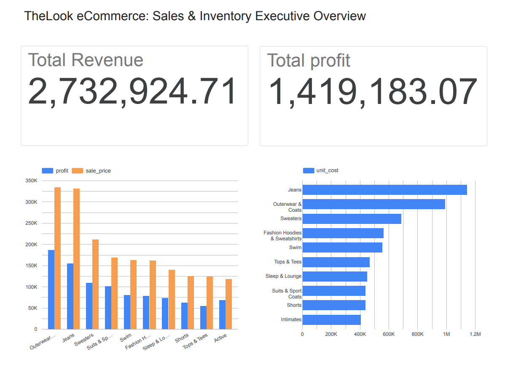

# TheLook eCommerce: Sales & Inventory Optimization Analysis

## 📌 Project Overview
This project is an end-to-end data analysis of **TheLook eCommerce**, a public dataset provided by Google BigQuery. The primary objective is to analyze transaction records and warehouse inventory to identify high-margin product categories, quantify capital tied up in dead stock, and provide actionable business recommendations to optimize cash flow.

**Tools & Technologies Used:** 
- **Database:** Google BigQuery (SQL)
- **Data Visualization:** Looker Studio
- **Version Control:** Git, GitHub
- **IDE:** Visual Studio Code

---

## 📑 Table of Contents
- [1. Ask Phase (Problem Definition & Objectives)](#1-ask-phase-problem-definition--objectives)
- [2. Prepare Phase (Data Verification & ROCCC)](#2-prepare-phase-data-verification--roccc)
- [3. Process Phase (Data Cleaning & Business Rules)](#3-process-phase-data-cleaning--business-rules)
- [4. Analyze Phase (Key Findings & SQL Outputs)](#4-analyze-phase-key-findings--sql-outputs)
- [5. Share Phase (Data Visualization & Reporting)](#5-share-phase-data-visualization--reporting)
- [6. Act Phase (Data-Driven Business Recommendations)](#6-act-phase-data-driven-business-recommendations)

---

# 1. Ask Phase (Problem Definition & Objectives)

### Business Context
The leadership team at The Look eCommerce wants to improve overall cash flow efficiency. 
While top-line sales have expanded, warehouse storage expenses are rising, and certain product lines appear to carry thin margins.

### Project Objective
Analyze order fulfillment and warehouse inventory records to identify margin drivers, quantify dead stock liability, and provide actionable recommendations for stock liquidation and marketing focus.

### Primary Business Questions
1. **Category Profitability:** What are the top 5 product categories by total profit and profit margin, versus those with high revenue but poor margins?
2. **Inventory Aging & Tied-up Capital:** How many inventory units have remained unsold for over 180 days, and what is the total capital tied up in this slow-moving stock?
3. **Order Value Distribution:** What percentage of total orders fall into low, medium, and high order-value brackets, and how does this affect average order profitability?

### Success Criteria & Key Metrics
- Gross Merchandise Value (GMV) & Total Realized Revenue
- Gross Profit Margin (%)
- Unsold Inventory Aging Distribution (Days in Warehouse)
- Total Tied-Up Inventory Cost ($)

# 2. Prepare Phase (Data Verification & ROCCC)
- **Dataset:** `bigquery-public-data.thelook_ecommerce` on Google BigQuery
- **ROCCC Assessment:**
  - **Reliable:** Managed dataset with consistent foreign keys and valid constraints.
  - **Original:** Standardized e-commerce transaction model by Looker/Google.
  - **Comprehensive:** Covers catalog items, basket items, orders, and unit-level warehouse storage.
  - **Current:** Includes timestamps extending into recent operational periods.
  - **Cited:** Google Cloud Public Datasets.

# 3. Process Phase (Data Cleaning & Business Rules)

### Data Quality Audit
- **Null Value Assessment:** Executed checks on primary keys (`id`, `order_id`, `product_id`) and critical financial measures (`sale_price`). Found **0 NULL records**, confirming high dataset completeness.
- **Data Anomaly Verification:** Checked for negative sale prices or transactions where `sale_price < cost`. No invalid or corrupt rows were detected.

### Order Status Distribution & Scope Definition
To ensure accurate revenue reporting, we audited item fulfillment statuses across all records:

| status     | total_items | percentage |
|------------|-------------|------------|
| Shipped    | 54344       | 30.03      |
| Complete   | 45119       | 24.94      |
| Processing | 36365       | 20.1       |
| Cancelled  | 27085       | 14.97      |
| Returned   | 18033       | 9.97       |

# 4. Analyze Phase (Key Findings & SQL Outputs)

### Finding 1: Profitability vs. Volume Disconnect
While **Jeans** generated the highest order volume (2,947 orders), **Outerwear & Coats** emerged as the primary business profit engine, yielding $194,147.34 in gross profit with a robust 55.60% margin. Additionally, **Suits & Sport Coats** achieved the highest margin efficiency across the catalog at 59.96%, yielding nearly $100k profit from just 1,288 orders.

| category                      | total_orders | total_revenue | total_profit | profit_margin_pct |
|-------------------------------|--------------|---------------|--------------|-------------------|
| Outerwear & Coats             | 2251         | 349190.04     | 194147.34    | 55.6              |
| Jeans                         | 2947         | 296485.03     | 137551.36    | 46.39             |
| Sweaters                      | 2694         | 206268.7      | 106870.95    | 51.81             |
| Suits & Sport Coats           | 1288         | 163876.28     | 98261.91     | 59.96             |
| Fashion Hoodies & Sweatshirts | 2971         | 166669.78     | 80047.7      | 48.03             |
| Swim                          | 2745         | 160510.1      | 79144.11     | 49.31             |
| Sleep & Lounge                | 2661         | 139065.41     | 72097.03     | 51.84             |
| Active                        | 2174         | 111486.08     | 64756.68     | 58.08             |
| Shorts                        | 2684         | 125148.2      | 62517.61     | 49.95             |
| Dresses                       | 1291         | 111471.7      | 61233.38     | 54.93             |

---

### Finding 2: Severe Working Capital Lockup in Slow-Moving Stock
Over **$2.13 Million in wholesale capital** is tied up in unsold inventory across just two categories: **Jeans** ($1.11M) and **Outerwear & Coats** ($1.01M). Unsold items have lingered in the warehouse for an average of **1,240+ days (~3.4 years)**, highlighting an aggressive over-procurement issue and high holding-cost exposure.

| category                      | unsold_items_count | avg_days_in_warehouse | tied_up_cost_usd |
|-------------------------------|--------------------|-----------------------|------------------|
| Jeans                         | 21217              | 1244.9                | 1116734.97       |
| Outerwear & Coats             | 15599              | 1247.3                | 1016433.04       |
| Sweaters                      | 18892              | 1238.5                | 688681.5         |
| Fashion Hoodies & Sweatshirts | 20034              | 1239.8                | 562759.64        |
| Swim                          | 19075              | 1251.9                | 549777.06        |
| Tops & Tees                   | 20605              | 1248.3                | 472840.94        |
| Sleep & Lounge                | 19051              | 1241.6                | 456415.64        |
| Shorts                        | 19171              | 1253.4                | 442943.47        |
| Suits & Sport Coats           | 8786               | 1247.4                | 437554.15        |
| Intimates                     | 22636              | 1243.0                | 407287.15        |

---

### Finding 3: Order Sizing & Revenue Concentration
There is a stark polarization in customer checkout behavior:
- **Low-value transactions (< $50)** account for **46.34%** of all completed orders but contribute only ~15% of gross revenue.
- **High & Premium baskets (> $100)** represent only **26.94%** of orders but drive over **62.3%** of total revenue ($1.67M+).

| basket_tier                 | total_orders | tier_revenue | order_percentage |
|-----------------------------|--------------|--------------|------------------|
| 1. Low Value (< $50)        | 14486        | 407883.06    | 46.34            |
| 2. Mid Value ($50 - $100)   | 8355         | 603558.91    | 26.73            |
| 3. High Value ($100 - $200) | 5717         | 823726.73    | 18.29            |
| 4. Premium (> $200)         | 2703         | 854116.64    | 8.65             |

---

# 5. Share Phase (Data Visualization & Reporting)

### Data Preparation (BigQuery Views)
To optimize query performance and seamlessly connect the data to Looker Studio, the analytical SQL logic was materialized into persistent BigQuery Views:

### Executive Dashboard

[🔗 Click here to view the Interactive Dashboard on Looker Studio](https://datastudio.google.com/reporting/014616b4-db7b-41ff-8c7c-8a6f39a642e7)

---

# 6. Act Phase (Data-Driven Business Recommendations)

### 1. Immediate Working Capital Recovery (Clearance Strategy)
- **Target:** Liquidate obsolete units in `Jeans` and `Outerwear & Coats` that have exceeded 365 days in warehouse storage.
- **Tactic:** Run a tiered warehouse clearance discount (e.g., 25–35% off). Because current gross margins are around 46–55%, the company can discount these items aggressively without selling at a net cash loss, unlocking over $1.5M in liquid cash flow.

### 2. Strategic Marketing Re-allocation
- Re-allocate 20% of ad spend from lower-margin, high-competition items (like Hoodies and Jeans) toward high-margin, high-ticket items like **Suits & Sport Coats (59.96% margin)**.

### 3. Basket Size Optimization (AOV Expansion)
- Since 46.34% of orders are under $50, introduce a **Free Shipping Threshold at $65** or a **"Bundle & Save" promotion (e.g., Buy Jeans, get a Top at 20% off)** to push Low-tier shoppers into the Mid-tier ($50–$100), directly boosting Average Order Value (AOV).

## 📬 Contact Me
- **LinkedIn:** https://www.linkedin.com/in/teerayut-vry/
- **Email:** teerayut.vry@gmail.com
